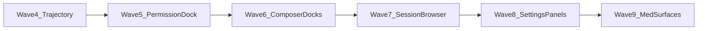

# Web UI parity — envoy-harness-web vs deepseek-harness

**Status:** living roadmap (post Waves 1–3)  
**Scope:** browser WebUI only (`packages/envoy-harness-web`). Not CLI/REPL/TUI.  
**Reference:** [`deepseek-harness/packages/client`](../../../deepseek-harness/packages/client) (Cordis `ui-*` modules)  
**Related:** [`gap-closure-plan.md`](./gap-closure-plan.md) §18–19 (EnvoyMesh EH docks), [`slash-catalog.ts`](../../envoy-harness-web/src/client/slash-catalog.ts)

---

## Honest baseline (what Envoy web has now)

Three-column ACP shell: sessions · chat · details.

| Area | Envoy today | Primary files |
|------|-------------|---------------|
| Composer | Lexical plain-text, slash palette, attachments, enter-behavior | `Composer.tsx`, `attachments.ts`, `slash-catalog.ts` |
| Queue | Edit / remove / clear; content-aware drain | `QueuePanel.tsx`, `App.tsx` |
| Sessions | Group by cwd, pin, rename, delete, project picker | `SessionRail.tsx`, `session-groups.ts` |
| Transcript | Markdown bubbles; folded status/activity | `Transcript.tsx`, `MarkdownBody.tsx` |
| Permissions / ask | Modals (allow/deny; single-line / options) | `PermissionModal.tsx` |
| Tools (EHUI) | plan, memory, git, team, scoreboard, trace, resume | `DetailsRail.tsx` + `@envoymesh/envoy-harness-ehui` |
| Mesh | Peers / sub-agents / steer | `MeshRail.tsx` |
| Files / preview | Lazy tree + text preview + attach path | `FileTreePanel.tsx`, `PreviewPanel.tsx` |
| Terminal | xterm PTY over ACP + tool-log fallback | `TerminalPanel.tsx`, `session/terminal/*` |
| Settings | Model · Permissions · Appearance tabs; Schedule/Goals in Details | `SettingsModal.tsx`, `SchedulePanel`, `GoalsPanel` |

**Out of scope for this roadmap:** full in-browser IDE (editor tabs + LSP + multi-pane IDE clone). That remains a later, optional composition of richer preview/browser — not a single wave.

---

## Biggest gaps (ranked)

### High — daily chat feel

| ID | Gap | DeepSeek reference | Envoy today |
|----|-----|--------------------|-------------|
| H1 | **Trajectory / tool rendering** — virtualized turns, nested tool cards, search | `ui-trajectory`, `ui-tool`, `ui-conversation` | **Wave 4:** `ToolCard` + live tool_call/result/progress. Still missing: virtualization, search, nested sub-agent trees |
| H2 | **Composer dock stack** — context strip, changes, turn hints above input | gap-closure §18 / EnvoyMesh EH docks; DSH dockkit | **Wave 6:** `ContextStrip` + `ChangesDock` + `TurnHintsDock`; jump to git-diff / preview |
| H3 | **Permission dock with diff/patch preview** | `ui-approval`; TUI `permission-preview.ts` | **Wave 5:** `PermissionDock` + edit/write/patch diffs; ask_user still modal |
| H4 | **Session / workspace browser depth** — search, archive, richer actions | `ui-workspace` / `WorkspaceBrowser.tsx` | **Wave 7:** filter + localStorage archive + mtime/msgs/cwd row meta |
| H5 | **Settings depth** — models, agent-loop, plugins, schedule/goals as UI | `ui-settings-*`, `ui-plugin-market`, `ui-schedule`, `ui-goal` | **Wave 8:** Settings tabs + Details Schedule/Goals; plugins still slash-only |

### Medium — product surfaces

| ID | Gap | Notes |
|----|-----|--------|
| M1 | Multi-thread / parallel chats per project | **M1:** session tabs + nested splits (row/col) with per-pane tab stacks |
| M2 | Dynamic slash catalog (`available_commands_update`) | **Wave 9:** live catalog from ACP; fallback catalog kept |
| M3 | Richer `ask_user` (multi-question, plan review) | **Wave 9:** recommended / multiline / multi-select (`AskUserModal`) |
| M4 | Schedule / goals / deliverables **panels** | **Wave 8:** Details Schedule/Goals panels |
| M5 | Context / token / compaction chrome | **Wave 9:** `ContextChrome` + `session/context` / compact |
| M6 | Live `tool_progress` as cards (not only status folds) | Overlaps H1 (Wave 4) |
| M7 | Richer preview / embedded browser sidebar | **Wave 9:** line numbers, md render, wrap/copy; **not** full IDE |

### Low / explicit non-goals (near term)

| ID | Gap | Why deferred |
|----|-----|----------------|
| L1 | i18n, shortcuts suite, analytics | Polish after High/Med |
| L2 | Account / billing / org admin | Round 8 non-goal |
| L3 | Cordis plugin marketplace UI | CLI/`/plugins` first; marketplace later |
| L4 | Full browser IDE | Too large; only after M7 + editor needs prove out |

---

## Fill plan — one wave at a time

Each wave: **ship → review → fix → next**. Do not start the next wave until typecheck + targeted tests are green and the previous wave’s acceptance checks pass.

### Wave 4 — Trajectory + tool cards (H1, M6)

**Goal:** Chat reads like an agent transcript, not a chat app dump.

- Structured turn model in the host (user / assistant / tool_call / tool_result / status).
- Render tool cards (name, args summary, result fold, error emphasis).
- Stream / show `tool_progress` where ACP already emits it.
- Optional: virtualize long transcripts (`@tanstack/react-virtual` or equivalent).

**Primary touch:** `acp/host.ts`, `Transcript.tsx`, `transcript-utils.ts`, new `ToolCard.tsx`  
**Accept:** A bash/read turn shows a card with expandable output; errors stay visible.

### Wave 5 — Permission dock + diff preview (H3)

**Goal:** Approvals match TUI usefulness without leaving the chat column.

- Replace or augment `PermissionModal` with a dock above the composer when a permission is pending.
- Reuse TUI/diff preview ideas (`permission-preview.ts`) for write/edit/apply_patch style tools.
- Keep Escape → deny / cancel consistent with current host behavior.

**Primary touch:** `PermissionModal.tsx` → `PermissionDock.tsx`, `App.tsx`, styles  
**Accept:** Edit/write permission shows a readable diff or path hunks, not only JSON.

### Wave 6 — Composer dock stack (H2)

**Goal:** Context around the prompt, not only the prompt itself.

- Context strip (cwd, attached/touched paths).
- Changes dock (git-diff / files_changed summary → jump to EHUI git-diff).
- Turn hints / follow-ups when ACP exposes them (`turnHints` already on client prompt result).

**Primary touch:** new `ContextStrip.tsx`, `ChangesDock.tsx`, `TurnHintsDock.tsx`, `App.tsx`  
**Accept:** After a turn with hints or file changes, docks appear without opening Details → Tools.

### Wave 7 — Session / workspace browser (H4)

**Goal:** Find and manage sessions like DeepSeek’s workspace browser — without a full IDE.

- Search filter (title / id / cwd).
- Archive (localStorage or server flag if we add a thin RPC).
- Clearer row metadata (mtime, message count already on wire).

**Primary touch:** `SessionRail.tsx`, `session-groups.ts`, maybe `session/list` enrichment  
**Accept:** Filter reduces a long list; archive hides without delete.

### Wave 8 — Settings + ops panels (H5, slice of M4)

**Goal:** Stop stuffing every ops surface into one modal + slash-only.

- Split Settings: Model · Permissions · Appearance (keep thin).
- Add DetailsRail or Settings sections for **Schedule** and **Goals** (wire existing agent/REPL capabilities over ACP if missing thin RPCs).

**Primary touch:** `SettingsModal.tsx`, EHUI or new panels, protocol only if list/create RPCs absent  
**Accept:** User can list/create a schedule or goal from the web UI without typing slash commands.

### Wave 9 — Medium surfaces (M1–M3, M5, M7)

Pick in this order unless product priority changes:

1. **M2** Dynamic slash from `available_commands_update`  
2. **M3** Richer `ask_user`  
3. **M5** Context / token / compact chrome  
4. **M1** Multi-thread (hardest; may stay EnvoyMesh-hosted)  
5. **M7** Richer preview / optional embedded browser — **still not full IDE**

---

## Working rules

1. **No Lexical rewrite** unless a wave explicitly needs it; Wave 2 Lexical stays.
2. **Prefer ACP + existing host seams** over cloning Cordis modules wholesale.
3. **EnvoyMesh docks (§18)** are a reference UX, not a hard dependency — port patterns into `envoy-harness-web` so the standalone web UI stays usable without EnvoyMesh.
4. **Full browser IDE** is not a wave on this board; revisit only after Wave 9 / M7 has clear demand.
5. After each wave: typecheck both packages, targeted vitest, short review/fix pass (same as Waves 1–3).

---

## Progress log

| Wave | Status | Notes |
|------|--------|-------|
| 1 — Composition UX + CLI ops | done | Composer extract, queue, sessions, settings, CLI dump/pwsh/profile |
| 2 — Lexical + attachments + files/preview | done | Lexical, attach, `workspace/fs/*`, Details Files/Preview |
| 3 — PS validators + interactive PTY | done | `permissions/powershell`, `session/terminal/*`, xterm |
| 4 — Trajectory + tool cards | done | `ToolCard`, `trajectory.ts`; activity keeps successful tool_result + progress |
| 5 — Permission dock | done | `PermissionDock` above composer; edit/write/apply_patch diff preview; Esc denies |
| 6 — Composer docks | done | `ContextStrip`, `ChangesDock`, `TurnHintsDock`; host tracks `changedFiles` + `turnHints` |
| 7 — Session browser | done | Filter title/id/cwd; archive hides without delete; richer mtime/msgs/cwd meta |
| 8 — Settings + schedule/goals | done | Settings Model/Permissions/Appearance tabs; `session/schedule` + `session/goals` RPCs; Details panels |
| 9 — Medium surfaces | done | M2–M3, M5, M7; **M1 tabs + nested multi-splits** (per-pane tabs, soft-switch, busy dots, drafts) |
